# Intelligent Email Copilot: Application Installation, Configuration & User Setup Document

---

## 1. Very Brief Application Overview

### What the Application Is
The **Intelligent Email Copilot** is a privacy-first, retrieval-augmented artificial intelligence (RAG) assistant designed for enterprise and customer support teams. It analyzes incoming support emails or user inquiries, retrieves precise answers directly from indexed company documentation, and drafts grounded email replies for human verification.

### Purpose of the Application
The core purpose is to automate repetitive tier-1 support queries while maintaining strict **human-in-the-loop** safety. The system **never sends emails automatically**. Every AI-generated response is saved either as a Gmail draft or staged in an approvals queue where human support agents must review, edit, and manually send each message.

### Main Features and Modules
* **Knowledge Base Ingestion & Management:** Drag-and-drop document upload (PDF, DOCX, TXT, Markdown, CSV) with correspondence-aware indexing, noise stripping, and automatic chunking.
* **Hybrid RAG Retrieval Engine:** Combines dense semantic vector search (ChromaDB + SentenceTransformers) with BM25 lexical keyword matching, fused by Reciprocal Rank Fusion (RRF) and re-ranked using a local cross-encoder.
* **Interactive Knowledge Base Test:** Standalone Q&A playground allowing team members to test document accuracy and cite sources without requiring email integration.
* **Interactive Email Test Simulator:** Real-time test sandbox that evaluates incoming email text against security checks, intent classification, knowledge retrieval, grounded drafting, and quality scoring.
* **Gmail OAuth Integration:** Multi-account Google OAuth 2.0 PKCE synchronization for reading unread emails and creating response drafts.
* **Human Review & Approvals Queue:** Dedicated dashboard to review, edit, reject, or approve draft replies.
* **Multi-Workspace Isolation:** Multi-client separation of branding, settings, accounts, and knowledge bases.

### Basic End-to-End Workflow

```mermaid
flowchart LR
    A[Incoming Customer Email] --> B[Security Screening]
    B --> C[Intent Classification]
    C --> D[ChromaDB + BM25 Hybrid Retrieval]
    D --> E[Cross-Encoder Reranking]
    E --> F[Grounded Answer Generation: Groq / Gemini / Ollama]
    F --> G[Quality & Factual Grounding Check]
    G --> H[Create Gmail Draft]
    H --> I[Human Agent Review & Approval]
    I --> J[Human Sends in Gmail]
```



### Main Technologies Used
* **Backend:** Python 3.11, [aiohttp](https://docs.aiohttp.org/) asynchronous web framework, [LangGraph](https://langchain-ai.github.io/langgraph/) orchestration state machine, [LangChain](https://www.langchain.com/).
* **Frontend:** Modern Vanilla JavaScript (ES Modules, reactive state management, hash-based SPA routing) and custom Vanilla CSS with dark/light design system tokens.
* **Database & Vector Store:** SQLite (`data/copilot.db`) for application state, accounts, workspaces, and drafts; [ChromaDB](https://www.trychroma.com/) (`data/chroma`) for dense vector embeddings.
* **AI / ML Models:** 
  * Large Language Model: **Groq**, **Google Gemini** or a local **Ollama** model, selectable at runtime (Settings → Advanced → AI service) with automatic fallback between providers. Defaults: Groq `openai/gpt-oss-120b`, fallbacks Gemini `gemini-3.5-flash-lite` and Ollama `qwen3:8b`.
  * Embedding Model: Local `sentence-transformers/all-MiniLM-L6-v2` (384-dimensional dense vectors).
  * Re-ranking Model: Local `cross-encoder/ms-marco-MiniLM-L6-v2`.
* **External Services:** Google Cloud Platform (Gmail REST API v1 via OAuth 2.0).

---

## 2. Prerequisites

### System Requirements

| Parameter | Minimum Requirement | Recommended Specification | Verified Current Environment |
|---|---|---|---|
| **Operating System** | Windows 10/11, Ubuntu 20.04+, macOS 12+ | Windows 11 / Ubuntu 22.04 LTS | Windows 11 Pro 64-bit |
| **CPU** | Dual-Core 2.0 GHz x86_64 | Quad-Core 3.0 GHz+ (Intel i5/i7 or AMD Ryzen) | Intel Core i7 / AMD Ryzen Multi-Core |
| **System RAM** | 4 GB RAM | 8 GB – 16 GB RAM | 16 GB RAM |
| **Disk Storage** | 3 GB free disk space | 10 GB+ SSD space (for models & cache) | NVMe SSD (>50 GB available) |
| **GPU Requirements** | None (CPU inference supported) | CUDA-enabled GPU (optional for embeddings) | CPU Execution (Torch 2.14.0) |
| **Python Runtime** | Python 3.10.x | Python 3.11.x | **Python 3.11.9** |
| **Node.js Runtime** | Not Required (Vanilla JS frontend) | Not Required | None required |
| **Database Engine** | Embedded SQLite 3 (built into Python) | Embedded SQLite 3 with WAL mode | SQLite 3.45+ (Standard Library) |
| **Vector Database** | Embedded ChromaDB 0.5+ | ChromaDB local persistent directory | ChromaDB 1.5.9 |
| **Network & Internet** | Internet for Groq / Gemini & Google OAuth (not needed for Ollama-only use) | Broadband (>10 Mbps) | Active Internet Connection |
| **Default Ports** | TCP 8000 (default) or TCP 8001 | Configurable port (8000–8080) | **TCP 8001** (active server) |
| **AI Services**| One of: Groq API key, Gemini API key, or a local Ollama install | Groq + Gemini keys, Ollama as local fallback, Google OAuth Client ID | Groq & Gemini keys configured, Ollama running |

### Libraries & Dependencies

The following table lists the exact dependencies detected and verified in the running virtual environment:

| Dependency | Exact Installed Version | Purpose in Application |
|---|---|---|
| **Python** | `3.11.9` | Primary backend execution runtime |
| **langgraph** | `1.2.12` | Multi-agent stateful workflow and cyclic execution graph |
| **langchain** | `1.4.2` | Core LLM abstractions and chain orchestrations |
| **langchain-core** | `1.6.5` | Base interfaces for prompts, documents, and messages |
| **langchain-chroma** | `1.1.0` | Vector store interface integrating ChromaDB with LangChain |
| **chromadb** | `1.5.9` | Embedded vector database for document embeddings storage |
| **sentence-transformers** | `6.1.0` | Local neural embedding generation (`all-MiniLM-L6-v2`) |
| **torch** | `2.14.0` | PyTorch runtime for running local transformer embeddings and rerankers |
| **transformers** | `5.17.0` | Hugging Face model architectures and tokenizer support |
| **pypdf** | `6.19.0` | PDF text extraction and parsing for uploaded knowledge documents |
| **python-docx** | `1.2.0` | Microsoft Word document parsing and ingestion |
| **pydantic** | `2.13.5` | Data validation, settings management, and structured schema typing |
| **aiohttp** | `3.14.3` | Asynchronous web server hosting the REST API and static single-page app |
| **cryptography** | `50.0.1` | Fernet symmetric key encryption for sensitive Gmail refresh tokens |
| **google-api-python-client** | `2.200.0` | Google Cloud API client for interacting with Gmail v1 REST services |
| **google-auth-oauthlib** | `1.4.1` | OAuth 2.0 PKCE authentication flow helper for Gmail |
| **requests** | `2.34.2` | HTTP client for the Ollama, Groq and Gemini APIs |
| **python-dotenv** | `1.2.3` | Reads configuration key-value pairs from `.env` file |
| **colorama** | `0.4.6` | Colored terminal logging and status diagnostics formatting |
| **pytest** | `9.1.1` | Automated test suite execution |

---

## 3. Installation & Configuration — Step by Step

### Step 1 — Source Code Setup
1. Clone or extract the project source code to your chosen working directory:
   ```powershell
   git clone <repository-url> email-automation-langgraph
   cd email-automation-langgraph
   ```
2. Verify the project directory layout:
   ```
   email-automation-langgraph/
   ├── app/
   │   ├── agents/          # Specialized LangChain agent components
   │   ├── gmail/           # Google Gmail API OAuth reader & draft writer
   │   ├── graph/           # LangGraph workflow graphs (workflow.py, knowledge_test.py)
   │   ├── llm/             # AI providers (Ollama, Groq, Gemini), client with fallback, runtime settings
   │   ├── prompts/         # Structured system and user prompts
   │   ├── rag/             # Ingestion, embeddings, lexical BM25, and reranker
   │   ├── services/        # Business logic (drafts, knowledge, accounts, workspaces)
   │   ├── store/           # SQLite database schema and persistence layer
   │   ├── web/             # aiohttp web server and single-page web app (static assets)
   │   └── config.py        # Central configuration module
   ├── data/
   │   ├── chroma/          # Persistent ChromaDB vector collections
   │   ├── documents/       # Raw knowledge base documents (PDF, DOCX, TXT)
   │   └── copilot.db       # SQLite application database
   ├── docs/                # Architecture documentation and presentation files
   ├── scripts/             # Utility and evaluation scripts
   ├── tests/               # Test suites
   ├── .env.example         # Template configuration file
   ├── requirements.txt     # Locked production dependencies
   └── run.py               # Unified CLI management entrypoint
   ```

### Step 2 — Runtime Setup
Verify that Python 3.10 or 3.11 is installed on the host machine:
```powershell
python --version
```
Expected output:
```text
Python 3.11.9
```

### Step 3 — Virtual Environment
Isolate application dependencies by creating and activating a dedicated Python virtual environment:
```powershell
# Create virtual environment named 'venv'
python -m venv venv

# Activate virtual environment on Windows PowerShell:
.\venv\Scripts\Activate.ps1

# (On Linux / macOS bash):
# source venv/bin/activate
```
Verify the active virtual environment:
```powershell
Get-Command python | Select-Object Source
```

### Step 4 — Install Dependencies
Install all required libraries specified in [requirements.txt](file:///c:/Users/krvam/OneDrive/Desktop/email-automation-langgraph/requirements.txt):
```powershell
python -m pip install --upgrade pip
pip install -r requirements.txt
```
Verify successful package installation:
```powershell
python -m pip list
```

### Step 5 — Environment Configuration
Create the active configuration file from the provided example template:
```powershell
Copy-Item .env.example .env
```
Open `.env` in an editor and configure the parameters. **All sensitive tokens and secrets must remain protected and never committed to source control.**

```ini
# =====================================================================
# Intelligent Email Copilot - Configuration
# =====================================================================

# Project & Branding
PROJECT_NAME=IntelligentEmailCopilot
COMPANY_NAME=Customer Support Team
PRODUCT_NAME=Intelligent Email Copilot

# AI providers (ollama | groq | gemini): primary + fallbacks, tried in order
LLM_PROVIDER=groq
LLM_FALLBACK_PROVIDERS=gemini,ollama
LLM_TEMPERATURE=0.1
LLM_MAX_TOKENS=2000
LLM_TIMEOUT=60
LLM_RETRY_COUNT=1

OLLAMA_BASE_URL=http://localhost:11434
OLLAMA_MODEL=qwen3:8b
OLLAMA_TIMEOUT=300

GROQ_API_KEY=your_groq_api_key_here
GROQ_MODEL=openai/gpt-oss-120b

GEMINI_API_KEY=your_gemini_api_key_here
GEMINI_MODEL=gemini-3.5-flash-lite

# Local Embeddings & ChromaDB
EMBEDDING_MODEL=all-MiniLM-L6-v2
EMBEDDING_SIMILARITY_FLOOR=
RERANKER_MODEL=cross-encoder/ms-marco-MiniLM-L6-v2
CHROMA_PERSIST_DIRECTORY=./data/chroma
KNOWLEDGE_BASE_PATH=./data/documents
CHUNK_SIZE=1000
CHUNK_OVERLAP=150
RETRIEVAL_TOP_K=5
RETRIEVAL_MAX_CHUNKS=8
RETRIEVAL_MAX_CONTEXT_CHARS=12000
RETRIEVAL_MIN_RELEVANCE=0.30

# LangGraph Execution & Inbox Polling
MAX_RETRIES=2
MAX_EMAILS_PER_RUN=15
EMAIL_CONCURRENCY=3

# Gmail OAuth & Credentials
GMAIL_CREDENTIALS_PATH=./credentials.json
GMAIL_TOKEN_PATH=./token.json
MY_EMAIL=support@yourcompany.com

# Web Application Security & Admin Controls
PUBLIC_BASE_URL=
ADMIN_TOKEN=
APP_SECRET_KEY=
MAX_UPLOAD_MB=20
```

*Note on Security:* The `APP_SECRET_KEY` is a 32-byte Fernet key used to encrypt OAuth refresh tokens at rest in SQLite. If omitted, the application generates a secure key on first boot in `data/.secret_key`.

### Step 6 — Database Setup
The system automatically initializes its SQLite schema and ChromaDB collections upon startup:
1. SQLite Database: Located at `data/copilot.db`, managed via WAL (Write-Ahead Logging) mode for concurrent access across worker threads. Stores accounts, workspaces, emails, drafts, activity logs, and knowledge test history.
2. ChromaDB Vector Store: Located at `data/chroma`, containing embedded chunk collections keyed by workspace ID.
3. Pre-load documents: Drop initial reference documents (PDFs, DOCX) into `data/documents/` and index them using:
   ```powershell
   python run.py ingest
   ```

### Step 7 — External Services
1. **AI providers (at least one):**
   * **Groq** — create a key at https://console.groq.com/keys and set `GROQ_API_KEY`.
   * **Google Gemini** — create a key at https://aistudio.google.com/apikey and set `GEMINI_API_KEY`.
   * **Ollama** (local, no key) — install from https://ollama.com, then `ollama pull qwen3:8b`. On a CPU-only machine the first request loads the model (about 30 s) and replies are slower than the hosted providers.
   * Providers retire models over time: pick current ones in *Settings → Advanced → AI service*, which lists the models each provider offers right now and tests them.
   * Verified by running: `python run.py test-llm`.
2. **Google Cloud Platform (Gmail API):**
   * Required only for reading live Gmail inboxes and pushing drafts.
   * In GCP Console, enable the **Gmail API**, configure OAuth consent screen, and create an OAuth 2.0 Web Application client.
   * Add the authorized redirect URI: `http://127.0.0.1:8001/api/email-accounts/oauth/callback`.
   * Download the JSON credentials file and save it as `credentials.json` in the root directory (or upload it via Settings > Advanced in the web UI).

---

## 4. Actually Running the Application

### Running System Diagnostics
Before launching the server, execute the unified status inspection tool:
```powershell
python run.py status
```
Actual CLI Output:
```text
=== Intelligent Email Copilot System Status ===
  PROJECT_NAME                  : IntelligentEmailCopilot
  COMPANY_NAME                  : Customer Support Team
  LLM_PROVIDER                  : groq
  LLM_FALLBACK_PROVIDERS        : gemini,ollama
  LLM_TEMPERATURE / MAX_TOKENS  : 0.1 / 2000
  LLM_TIMEOUT / RETRY_COUNT     : 60 / 1
  OLLAMA_BASE_URL               : http://localhost:11434
  OLLAMA_MODEL                  : qwen3:8b
  GROQ_API_KEY_CONFIGURED       : True
  GROQ_MODEL                    : openai/gpt-oss-120b
  GEMINI_API_KEY_CONFIGURED     : True
  GEMINI_MODEL                  : gemini-3.5-flash-lite
  EMBEDDING_MODEL               : all-MiniLM-L6-v2
  RERANKER_MODEL                : cross-encoder/ms-marco-MiniLM-L6-v2
  CHUNK_SIZE / OVERLAP          : 1000 / 150
  RETRIEVAL_TOP_K / MAX_CHUNKS  : 5 / 8
  RETRIEVAL_MIN_RELEVANCE       : 0.3
  EMAIL_CONCURRENCY             : 3
  CHROMA_PERSIST_DIRECTORY      : C:\Users\krvam\OneDrive\Desktop\email-automation-langgraph\data\chroma
  KNOWLEDGE_BASE_PATH           : C:\Users\krvam\OneDrive\Desktop\email-automation-langgraph\data\documents
  MAX_RETRIES                   : 2
  MAX_EMAILS_PER_RUN            : 15
  GMAIL_CREDENTIALS_EXISTS      : False
  GMAIL_TOKEN_EXISTS            : False
  MY_EMAIL                      : ratnavamsik@gmail.com
================================================
```

### Verifying LLM Connectivity
```powershell
python run.py test-llm
```
Actual CLI Output:
```text
[INFO] Testing Ollama...
[SUCCESS] Ollama (qwen3:8b) replied in 2.74s: OK

[INFO] Testing Groq...
[SUCCESS] Groq (openai/gpt-oss-120b) replied in 1.45s: OK

[INFO] Testing Google Gemini...
[SUCCESS] Google Gemini (gemini-3.5-flash-lite) replied in 2.15s: OK

Active provider: Groq (model: openai/gpt-oss-120b); order tried: groq, gemini, ollama
```

### Verifying Semantic Retrieval (RAG)
```powershell
python run.py test-rag "How to reset password for RC Portal?"
```
Actual CLI Output:
```text
[INFO] Testing RAG retrieval for query: 'How to reset password for RC Portal?'
Loading weights: 100%|##########| 103/103 [00:00<00:00, 2900.96it/s]
Loading weights: 100%|##########| 105/105 [00:00<00:00, 2972.56it/s]
[INFO] Retrieved 5 matching document chunks:

--- Result 1 (Source: Re_ Fwd_ Re_ Urgent_ Login Issues on RC Portal.pdf) ---
Dear Madam,
As per the telephonic discussion, the issue has been resolved during the password
change process, and the password has been reset to the default password:
[redacted].
...
--- Result 2 (Source: Re_ Request for Backend Reset of Passwords for All State Line Departments – Arunachal Pradesh.pdf) ---
Please inform all department users to use the 'Forgot Password' option available on the portal...
The default password for first-time login is [redacted]
```

### Starting the Web Application
Start the aiohttp web server on port 8001:
```powershell
python run.py web --port 8001
```
Actual Server Startup Output:
```text
====================================================================
  Intelligent Email Copilot
  Open http://127.0.0.1:8001 in your browser
====================================================================
```

### Health & API Verification
Verify the server health endpoint via REST:
```powershell
Invoke-RestMethod -Uri "http://127.0.0.1:8001/api/app" -Method Get
```
Returned JSON:
```json
{
  "workspace": { "id": "default", "name": "Support Team" },
  "branding": {
    "product_name": "Email",
    "company_name": "Support Team",
    "primary_color": "#4f46e5"
  },
  "is_admin": true,
  "ai_available": true,
  "tones": ["professional", "friendly", "formal", "concise"]
}
```

---

## 5. Real Screenshots from the Running Environment

Every screenshot below was captured directly from the live running web application and test environment.

### Figure 1 — Home & Workspace Dashboard


> **Figure 1 — Home & Workspace Dashboard**  
> Displays the primary landing screen showing workspace readiness status badges, live status of the Knowledge Base (31 documents ready), AI Service (Available), and direct quick actions to test knowledge or launch the email assistant.

---

### Figure 2 — Knowledge Base Document Repository


> **Figure 2 — Knowledge Base Document Repository**  
> Shows the drag-and-drop document upload interface and the indexed repository containing 31 PDF files, their respective chunk counts, file sizes, and "Ready" vectorization status.

---

### Figure 3 — Knowledge Base Test & Verification Console


> **Figure 3 — Knowledge Base Test Console**  
> Illustrates the interactive Q&A testing module where team members can query documents without connecting Gmail, review past test history, and inspect citations.

---

### Figure 4 — Interactive Email Test Sandbox Interface


> **Figure 4 — Interactive Email Test Sandbox Interface**  
> Displays the clean two-pane email simulator where incoming emails with sender, subject, and body can be simulated against the end-to-end AI workflow.

---

### Figure 5 — Live Execution & AI Grounded Response Generation


> **Figure 5 — Live Execution of Email Test with Grounded Reply**  
> Confirms the successful live execution of the LangGraph pipeline: Security Check passed, Category classified as Question, Quality evaluated at 10/10, request extracted, and exact document excerpt cited from `Re_ Regulatory Compliance Portal - Help with Log in Id & Password.pdf`.

---

### Figure 6 — Email Assistant & Operational Workflow Architecture


> **Figure 6 — Email Assistant Architecture**  
> Illustrates the pipeline flow: New Email → Understand Email → Identify Question → Search Knowledge → Generate AI Response → Create Gmail Draft → Human Review → Human Sends.

---

### Figure 7 — Email Accounts & Integration Hub


> **Figure 7 — Email Accounts Hub and Security Guarantees**  
> Confirms the OAuth integration management view and highlights the strict policy: "Send emails (Disabled): Every reply stays a draft until a person sends it from Gmail."

---

### Figure 8 — Human Review & Approvals Queue


> **Figure 8 — Human Review & Approvals Queue**  
> Displays the queue where drafts generated by the background worker await human editorial approval before being dispatched through Gmail.

---

### Figure 9 — Drafts Management Console


> **Figure 9 — Drafts Management Console**  
> Shows draft synchronization with Gmail, allowing support leads to track pending, approved, edited, and rejected drafts.

---

### Figure 10 — Incoming Emails Monitoring View


> **Figure 10 — Incoming Emails Monitoring View**  
> Presents the live table of ingested emails, categorizations, processing timestamps, and background job indicators.

---

### Figure 11 — General Workspace & Branding Settings


> **Figure 11 — General Workspace & Branding Settings**  
> Shows options for customizing the application name, company brand name, contact support email, primary brand theme color, and custom logo upload.

---

### Figure 12 — AI Tone & Fallback Behavior Preferences


> **Figure 12 — AI Tone & Fallback Behavior Preferences**  
> Demonstrates configuration options for AI reply tone (Professional, Friendly, Formal, Concise), email signature formatting, and automated fallback actions when the Knowledge Base lacks an answer.

---

### Figure 13 — Advanced Administration & Service Endpoints


> **Figure 13 — Advanced Admin Settings**  
> Displays the AI service: the provider answering now, the primary provider, fallback providers, a model list per provider (fetched live from Ollama, Groq and Gemini) with a Test button for each, plus the Google OAuth callback redirect configuration. API keys are never shown.

---

### Figure 14 — Security Policies & Access Controls


> **Figure 14 — Security Policies & Access Controls**  
> Summarizes active security guarantees: no automatic sending, AES/Fernet token encryption, instantaneous Google access revocation, prompt injection screening, and local administrator detection.

---

### Figure 15 — Email Processing & Polling Controls


> **Figure 15 — Email Processing & Polling Controls**  
> Displays background inbox polling settings, maximum email processing limits per batch, look-back windows, and concurrency thresholds.

---

### Figure 16 — Built-in Help Center & User Guide


> **Figure 16 — Built-in Help Center & User Guide**  
> Displays the integrated end-user guide explaining how the copilot assists human support operators, addresses frequently asked questions, and clarifies safe email draft handling.

---

## 6. Application Verification

Every item below has been executed and physically tested in the live environment:

| Test Case | Expected Result | Actual Result | Status |
|---|---|---|---|
| **Python Runtime Verification** | Python version 3.10+ detected | Python 3.11.9 running in virtual environment | **PASS** |
| **Dependency Integrity** | All core libraries installed without import errors | 100% requirements verified (`pip list` matches) | **PASS** |
| **System Status Diagnostic** | `python run.py status` exits with 0 and prints config | Exited 0 with all paths and settings resolved | **PASS** |
| **AI Provider Connectivity** | Ollama, Groq and Gemini each answer a test request | All three replied "OK" (`python run.py test-llm`) | **PASS** |
| **Vector Store (ChromaDB) Retrieval** | Relevant document chunks returned for sample query | 5 chunks returned with source filenames cited | **PASS** |
| **Cross-Encoder Reranker** | Top passage re-scored to match inquiry intent | Reranker sorted password reset solution to rank 1 | **PASS** |
| **Backend Web Server Startup** | Web server starts on assigned port without crashing | aiohttp listening on `http://127.0.0.1:8001` | **PASS** |
| **Web REST API Health Check** | `/api/app` returns valid workspace & capabilities | Returned HTTP 200 with workspace `default` | **PASS** |
| **Dashboard Metrics API** | `/api/dashboard/stats` returns accurate document counts | Returned 31 documents indexed, 0 errors | **PASS** |
| **Knowledge Base Q&A Workflow** | Query returns grounded answer with exact citations | Answered in 6 seconds citing 4 real PDF documents | **PASS** |
| **End-to-End Email Simulator** | Full LangGraph execution: Security → Category → Knowledge → Draft → Quality | Reply ready, Quality 10/10, cited source snippet | **PASS** |
| **Web Frontend User Interface** | SPA loads smoothly, routing between all views | All 11 pages rendered without JavaScript errors | **PASS** |

---

## 7. Troubleshooting

### Issue 1: Port Conflict on Default Port 8000
* **Problem:** Launching `python run.py web` failed or conflicted because TCP port 8000 was already bound to another process on the system.
* **Cause:** A pre-existing local service was listening on `127.0.0.1:8000`.
* **Solution:** Launched the application specifying a free port:
  ```powershell
  python run.py web --port 8001
  ```
* **Verification:** Confirmed the aiohttp server bound cleanly to `http://127.0.0.1:8001` and responded with HTTP 200 on `/api/app`.

### Issue 2: Windows Console Unicode Encoding Error (`cp1252`)
* **Problem:** Automation script crashed with `UnicodeEncodeError: 'charmap' codec can't encode character '\u2192'` when printing server status messages containing arrow characters (`→`).
* **Cause:** Default Windows PowerShell / CMD terminal codepage is `cp1252` (Western European), which cannot encode specific Unicode mathematical arrows.
* **Solution:** Replaced Unicode characters in terminal print statements with ASCII equivalents or set UTF-8 console output:
  ```powershell
  [Console]::OutputEncoding = [System.Text.Encoding]::UTF8
  $env:PYTHONIOENCODING = "utf-8"
  ```
* **Verification:** Automation script ran to completion without character encoding exceptions.

### Issue 3: Gmail Connection Shows "Not Configured"
* **Problem:** In Email Accounts, the status displays "Gmail Disconnected" and clicking "Connect Gmail" fails.
* **Cause:** `credentials.json` (Google Cloud OAuth Client credentials) has not been placed in the root directory or uploaded via Settings.
* **Solution:** Obtain `credentials.json` from the Google Cloud Console (OAuth 2.0 Web Client) with redirect URI `http://127.0.0.1:8001/api/email-accounts/oauth/callback`, then upload it in **Settings > Advanced > Gmail sign-in**.
* **Verification:** Settings displays "Configured" with a green badge, and the OAuth consent screen opens properly.

### Issue 4: Vector Index Initial Loading Latency
* **Problem:** First query to `test-rag` or first Knowledge Test takes 8–12 seconds to return.
* **Cause:** The PyTorch models for SentenceTransformers (`all-MiniLM-L6-v2`) and cross-encoder (`ms-marco-MiniLM-L6-v2`) load weights from disk into memory on first invocation.
* **Solution:** This is normal initial warm-up behavior. Subsequent queries execute in under 1 second as weights remain resident in memory.
* **Verification:** Repeated retrieval queries completed instantaneously.

---

## 8. Constraints & Limitations

| Category | Constraint / Limitation | Detail / Handling |
|---|---|---|
| **Autonomous Email Dispatch** | Strict limitation: No automatic sending | The application has no code path that calls `gmail.send()`. All replies are saved exclusively as Gmail drafts for human review. |
| **Operating System** | Platform support | Supported on Windows, Linux, and macOS. On Windows, ensure console UTF-8 support is enabled. |
| **Python Version** | Version boundary | Requires Python >= 3.10. Verified on Python 3.11.9. Python 3.13 is currently not recommended due to torch/chromadb wheel compatibility. |
| **GPU Acceleration** | Hardware requirement | CPU inference is fully supported for embeddings and rerankers. GPU is optional and not required. |
| **Third-Party AI Dependency** | Internet connectivity required for hosted providers | Groq and Gemini need network access; when one fails the next provider in the chain answers, and a local Ollama model keeps working offline. If every provider fails, a holding reply is drafted and the email is marked for human review. |
| **Document File Formats** | Supported ingestion formats | PDF (`.pdf`), Microsoft Word (`.docx`), Plain Text (`.txt`), Markdown (`.md`), CSV (`.csv`). Scanned images inside PDFs require OCR preprocessing. |
| **File Size Limit** | Maximum document upload size | Enforced at 20 MB per file (configurable via `MAX_UPLOAD_MB` in `.env`). Up to 20 files per upload batch. |
| **Gmail OAuth Scopes** | Security permissions | Requests `gmail.modify` (to read and label) and `gmail.compose` (to create drafts). Never requests full inbox deletion permissions. |
| **Multi-Tenancy** | Workspace isolation | Workspaces isolate documents, drafts, and settings. Switching workspaces in the top header filters all views. |
| **Vector DB Concurrency** | SQLite/Chroma file locking | ChromaDB and SQLite use local file storage; distributed multi-node clustering is **To Be Confirmed** for future releases. |

---

## 9. Final Installation Checklist & Status Summary

### Installation & Verification Checklist
- [x] Source code cloned and workspace structure verified
- [x] Python 3.11 runtime verified (`Python 3.11.9`)
- [x] Dedicated virtual environment created and activated
- [x] All 21 production dependencies installed via `requirements.txt`
- [x] Environment configuration file (`.env`) created with secrets masked
- [x] SQLite database (`copilot.db`) schema initialized
- [x] ChromaDB vector store populated with 31 reference documents
- [x] AI providers verified (`python run.py test-llm`: Ollama, Groq, Gemini)
- [x] Hybrid RAG retrieval engine tested (`python run.py test-rag`)
- [x] Backend aiohttp web server running successfully on port 8001
- [x] Frontend Single-Page Application verified across all 11 routes
- [x] REST API endpoints (`/api/app`, `/api/dashboard/stats`) validated
- [x] End-to-end interactive Knowledge Test executed with grounded citations
- [x] End-to-end interactive Email Test executed (Security, Classification, Draft, Quality)
- [x] 16 real screenshots captured from live application and embedded

---

### Final Status Summary

* **Installation Status:** **COMPLETE & VERIFIED (PASS)**
* **Application Run Status:** **RUNNING & ACCESSIBLE** on `http://127.0.0.1:8001`
* **End-to-End Test Status:** **100% PASS** (RAG Retrieval, AI providers, Knowledge Test, Email Simulator)
* **Known Issues:** TCP port 8000 was occupied by another process; resolved by binding to port 8001. Windows console requires UTF-8 codepage for arrows.
* **Remaining Configuration Required:** To connect a live Gmail inbox for background polling, upload `credentials.json` via **Settings > Advanced > Gmail sign-in**. Standalone Knowledge Base testing and Email Test simulations require no additional setup and are fully operational.
